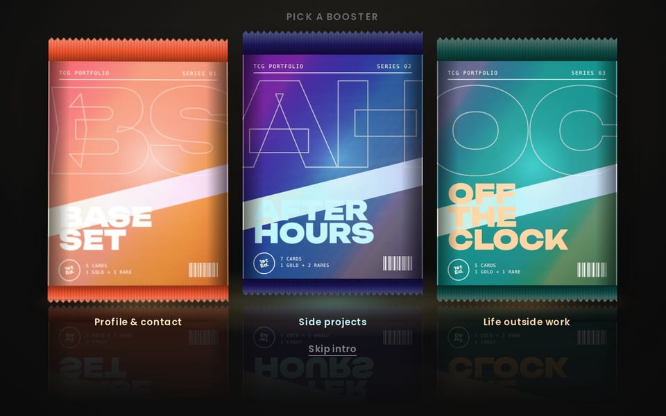
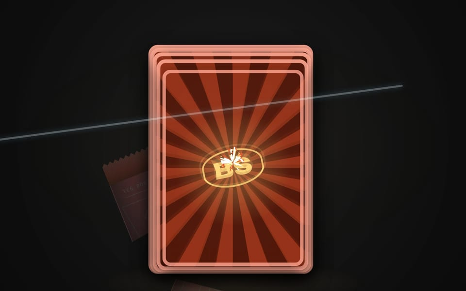
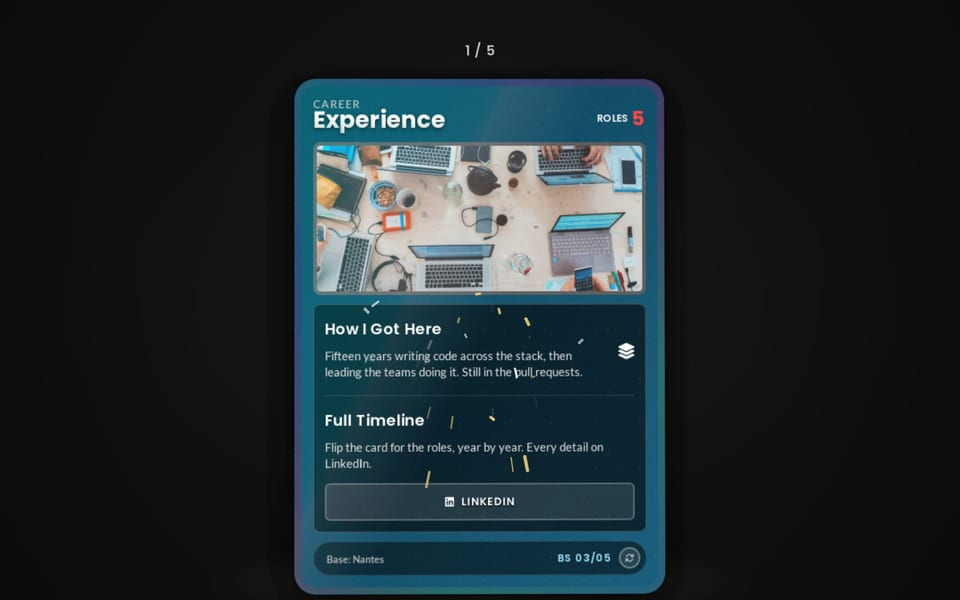
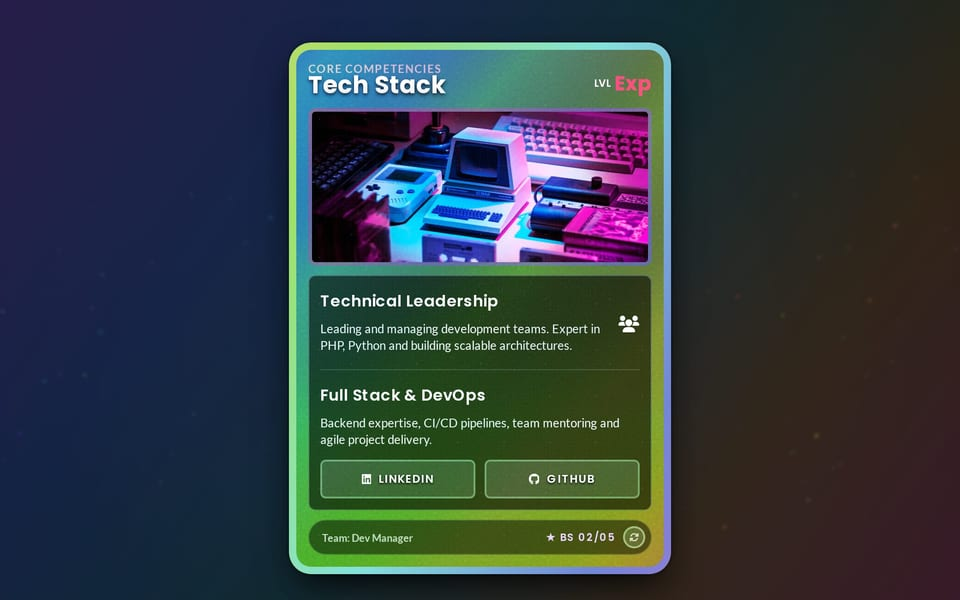
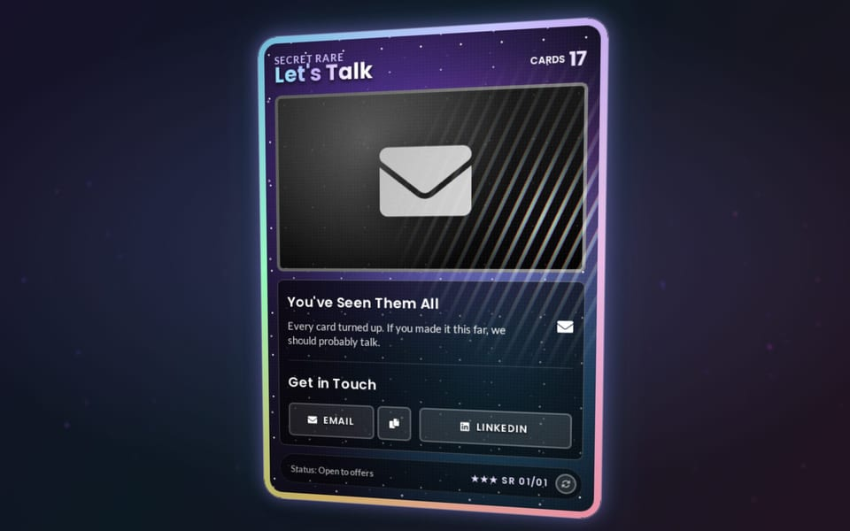
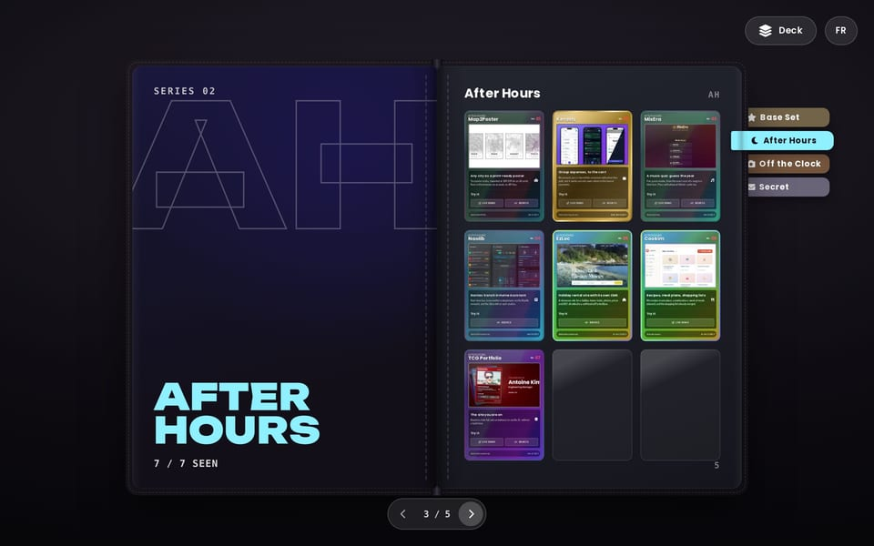

<p align="center">
  
</p>

<h1 align="center">TCG Portfolio</h1>

<p align="center">
  <a href="https://antoine.kim"></a>
  
  
  <a href="LICENSE"></a>
</p>

<p align="center">
  A portfolio you <b>collect</b>: open booster packs, flip holographic cards<br>
  and fill a binder, in plain HTML, CSS and JS.
</p>

<p align="center">
  <a href="https://antoine.kim"><b>🎴 Live demo → antoine.kim</b></a>
</p>

<table>
  <tr>
    <td width="33%"><br><sub><b>Pick a booster</b></sub></td>
    <td width="33%"><br><sub><b>Slice it open</b></sub></td>
    <td width="33%"><br><sub><b>Reveal the cards</b></sub></td>
  </tr>
  <tr>
    <td><br><sub><b>Holo rares</b></sub></td>
    <td><br><sub><b>Unlock the secret rare</b></sub></td>
    <td><br><sub><b>Fill the binder</b></sub></td>
  </tr>
</table>

## Features

- **Holographic cards** with foil, glitter and glare, tilting with the mouse or the phone's gyroscope.
- **Rarities**: rare ★, gold ★★ and secret ★★★ cards, each with its own finish and booster reveal.
- **Boosters**: slice a pack open, flip the cards one by one, watch them fly into your collection.
- **Binder**: a page-turning book with one tab per set, cards to pull out and handle full size.
- **Secret set**: see every card to unlock a hidden booster.
- **Deck navigation**: throw, scroll, arrow keys, a scrubber, and deep links (`/#projects`).
- **English & French**, accessible, responsive, and the collection survives in `localStorage`.

## Quick start

```bash
git clone https://github.com/dim4k/tcg-portfolio.git
cd tcg-portfolio
python -m http.server 8000   # any static server works
```

Open http://localhost:8000. ES modules need HTTP, so `file://` won't do.

**Deploy:** upload `index.html` and `public/` to any static host (GitHub Pages, Netlify, nginx, S3…).

## Make it yours

Everything lives in [`public/js/config.js`](public/js/config.js). Cards are grouped in **sets**:
each set becomes a booster, a binder section and a slice of the deck.

```javascript
SETS: [
    {
        id: "base",
        code: "BS",                       // printed before collector numbers
        name: "Base Set",
        booster: { color: "#f0532b", highlight: "#ffd77a" },
        cards: [
            {
                theme: "fire",
                rarity: "rare",           // "rare" | "gold" | "secret"
                slug: "profile",          // antoine.kim/#profile
                header: { stage: "Professional Profile", name: "Your Name" },
                back: { title: "…", items: [{ label: "…", text: "…" }] },
            },
        ],
    },
],
```

| What               | Where                                                                                                 |
| ------------------ | ----------------------------------------------------------------------------------------------------- |
| French texts       | [`public/js/locales/fr.js`](public/js/locales/fr.js), anything missing falls back to English         |
| Themes             | `--bg-*` / `--color-*` in `public/css/modules/base.css` + a block in `public/css/components/tcg-card.css` |
| Physics            | `GYRO_SENSITIVITY`, `MOUSE_ROTATION_FACTOR`, `THROW_DISTANCE` in `config.js`                          |
| Pictures           | JPEG in `public/img`, plus AVIF (q≈52) and WebP (q≈76) copies, 800px wide                              |
| Share preview      | Screenshot `tools/og-image.html` at 1200×630 to `public/img/og-image.jpg`                             |

A set can also list `projects` instead of `cards`, or be marked `secret: true` to stay hidden until
every other card has been seen.

## License

MIT, by [Antoine Kim](https://antoine.kim). Fork it and make your own deck!
